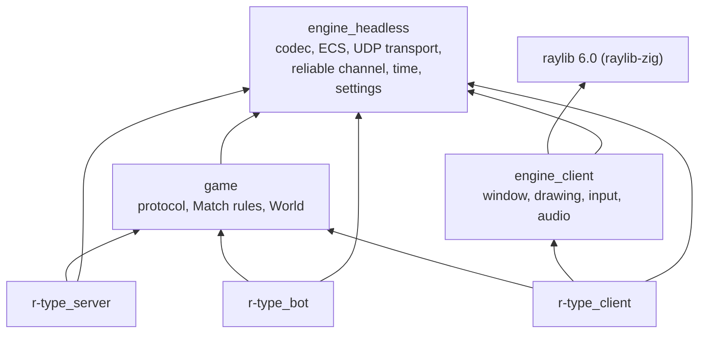
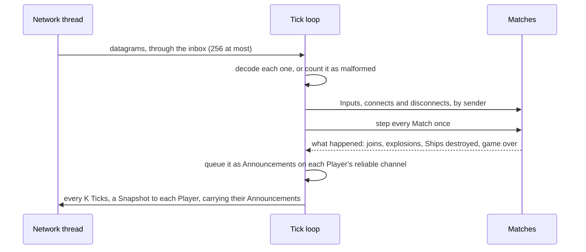

# Developer guide

How the code is organised, how a Tick goes through the Server and a Frame through the Client, and how to make the usual changes. The words are the [glossary](glossary.md)'s; the reasons for the big choices are in the [decision records](adr/README.md).

## Layers

The code is split into an Engine that knows nothing about R-Type, the Game built on it, and three programs ([ADR 0001](adr/0001-engine-game-boundary.md)). Each part is a Zig module, and a module can only import the modules `build.zig` gives it. `build.zig`'s `checkLayering` refuses any other import every time the build is configured, and `engine/client/api_check.zig` refuses, at compile time, any public declaration of the client Engine that would expose a raylib type.



The Server and the bot link no graphics or audio library: they build and run on a machine without a screen.

## Where things are

| Path | What it holds |
|---|---|
| `engine/headless/bytes.zig` | Little-endian encoding, derived from a type's declaration at compile time |
| `engine/headless/ecs.zig` | The ECS: one fixed-capacity table per kind of entity, and queries over them ([ADR 0006](adr/0006-one-table-per-kind-of-entity.md)) |
| `engine/headless/net.zig` | The UDP transport: a socket, its network thread, and a bounded inbox |
| `engine/headless/reliable.zig` | The reliable channel: sequence numbers, acknowledgements, resends, ordered delivery, and the Connection's measurements |
| `engine/headless/time.zig` | Fixed-step timing on the monotonic clock |
| `engine/headless/settings.zig` | Loading a ZON settings file, and writing its commented defaults |
| `engine/client/root.zig` | The window, drawing, textures, keys and buttons turned into Actions, and sounds |
| `game/protocol.zig` | Every message and its wire format: the code side of the [protocol spec](protocol.md) |
| `game/match.zig` | A Match: its phases, its Players, and its systems, run in a fixed order each Tick |
| `game/rules.zig`, `game/world.zig` | The numbers the Match plays by, and its World's tables |
| `server/main.zig`, `server/matches.zig` | The Server's Tick loop, its Connections and reports, and which Match takes a new Player |
| `client/` | The Client: its connection to the Server, interpolation, drawing, HUD, sounds and settings |
| `bot/main.zig` | Scripted headless Clients, for load tests and measurements |

## A Tick on the Server

The Server runs two threads. Each transport's network thread blocks on its socket and puts every datagram it receives into the inbox, dropping and counting what does not fit. The main thread runs the Tick loop, 60 times a second:



`Match.step` runs the Match's systems over its World: drop the silent Players, move the Ships, fire, spawn Waves, move everything, hit, and remove what is spent. Systems only mark rows; separate removal steps take them out, so nothing changes under a loop.

## A Frame on the Client

The Client also has a network thread and a main thread. Each Frame, the main thread:

1. drains the inbox: the reliable channel takes each datagram's acknowledgements and Announcements, and each new Snapshot becomes a Scene, kept by the interpolation;
2. for each Tick due, reads the Actions held and sends an Input carrying the last three Ticks;
3. draws the Match about two Snapshot intervals behind the newest, each entity moved between the two Scenes around that moment (`client/interpolation.zig`), then the effects and the HUD.

Announcements are handled before the Scene of the same datagram, so that an explosion is still drawn where its Enemy was.

## Building and testing

```sh
zig build                          # the three programs, in zig-out/bin
zig build test                     # every module's unit tests
zig build server -- --matches 1    # run a program, with its options after --
```

The checks of `.jj-ci.toml` run on every pull request, on Linux and Windows: formatting, the build (and with it the layering and API checks), the tests, and a Windows build kept as an artifact.

To try a full session on one machine:

```sh
zig-out/bin/r-type_server --stats session.csv &
zig-out/bin/r-type_bot --clients 20 --seconds 60
```

## How to

### Add a message

1. Add its type to `MessageType` and its body to `Message` in `game/protocol.zig`. A plain struct of integers, enums and packed structs needs no encoder: `ByteWriter` and `ByteReader` derive one from its fields, in declaration order.
2. Give it a `validate` function if some values are out of range: the decoder calls it.
3. Handle it in `Server.handle` and the Client's receive loop.
4. Add its byte layout and a test vector to the [protocol spec](protocol.md), and the same bytes to `protocol.zig`'s tests.

### Add a kind of Enemy

1. Add a table for it to `game/world.zig`, as big as its share of the Enemy budget.
2. Add its numbers to `game/rules.zig`, and a system for its movement to `game/match.zig`'s `step`.
3. Add a section to `Snapshot` in `game/protocol.zig`. The compile-time check there fails if a Snapshot of full tables no longer fits in one datagram.
4. Add its sprite to `client/sprites.zig` and draw it in `client/view.zig`, and match it by id in `client/interpolation.zig`.

### Change a setting's default

The Client's settings are `Settings` in `client/settings.zig`, and `client/settings.zon` is the file written for the Player, with its comments. A test checks that the two agree.

## Contributing

- **Branches and pull requests:** one short branch per change, opened against `main` with the pull request template, and squash-merged with a `/merge` comment, which needs an approval and green checks.
- **Commits and pull request titles:** `area: imperative summary`, lowercase, at most 72 characters, such as `client: interpolate between snapshots`. The area is the part of the code the change touches. The pull request's Summary becomes the commit's body.
- **Words:** name things as the glossary does: a Match, not a game or a session; a Projectile, not a bullet.
- **Code:** `zig fmt`. Every file starts with a `//!` comment saying what it is for, and public declarations have `///` comments. Tests sit beside the code they test.
- **Decisions:** a choice that would be costly to reverse, and that a newcomer would wonder about, gets an ADR in `docs/adr/`.
