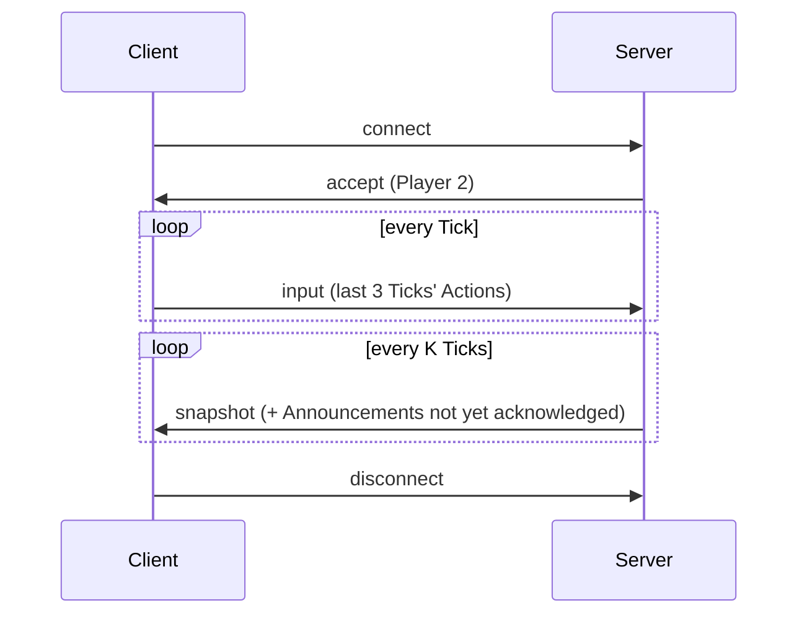
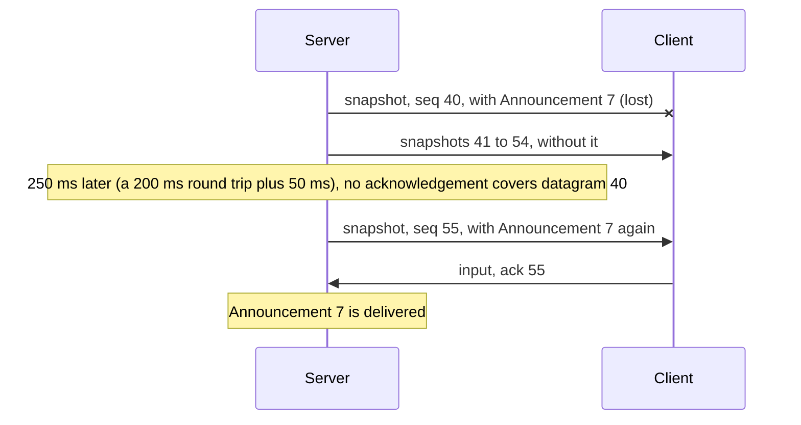

# The R-Type protocol, version 2

**Status:** what `r-type_server` and `r-type_client` speak since v1.0.0. This page is enough to write a Client of your own: every byte, every value and every error is here.

## 1. Conventions

The key words MUST, MUST NOT, REQUIRED, SHALL, SHALL NOT, SHOULD, SHOULD NOT, RECOMMENDED, MAY and OPTIONAL are to be read as described in [RFC 2119](https://www.rfc-editor.org/rfc/rfc2119) and [RFC 8174](https://www.rfc-editor.org/rfc/rfc8174) when, and only when, they appear in capitals.

- **Integers** are unsigned (`u8`, `u16`, `u32`) or two's complement (`i16`), and **little-endian**. There is no padding between fields, and no alignment.
- **Offsets** count bytes from the start of the UDP payload.
- A **Tick** is one step of the Server's simulation: 60 per second. Server Ticks and Client Ticks are counted separately, from 1, and wrap at 2³².
- A **coordinate** is a position in pixels on a 1280 × 720 field, `x` to the right and `y` downwards, of an entity's top-left corner. It is an `i16`, since entities stand partly off screen as they enter and leave.
- The words Server, Client, Player, Match, Ship, Enemy, Projectile, Snapshot, Announcement, Input, Connection and Tick are used as the [glossary](glossary.md) defines them.

## 2. Overview

A Client sends its Player's Input every Tick; the Server answers with a Snapshot every K Ticks, K being 1 unless the Server says otherwise (`--snapshot-every`). Snapshots carry where every entity stands and are never resent: a lost one is replaced by the next. What a Player must not miss, such as a Player leaving or a Ship destroyed, is an Announcement, carried on a small reliable channel that rides on every datagram (§6).



A Server runs several Matches at once, each for up to four Players, and puts each new Client in the first Match that takes it. A Client never sees which Match it is in: everything below is about its own.

## 3. Transport

- Every message travels in one UDP datagram, and every datagram holds exactly one message. The Server listens on port 4242 unless configured otherwise.
- A datagram MUST NOT carry more than **1,200 bytes** of UDP payload ([ADR 0005](adr/0005-datagrams-of-at-most-1200-bytes.md)). A receiver MUST drop a larger one.
- The Server identifies a Connection by the Client's IP address and UDP port. A Client MUST send every datagram of a Connection from the same port.

## 4. Datagram layout

Every datagram is a header, a message body, then the reliable section.

| Offset | Size | Field | Value |
|---|---|---|---|
| 0 | 2 | protocol id | `0x5452`: the bytes `52 54`, "RT" |
| 2 | 1 | version | `2` |
| 3 | 1 | message type | §5 |
| 4 | 2 | sequence | this datagram's number, §6 |
| 6 | 2 | ack | the latest sequence number received, §6 |
| 8 | 4 | ack bits | bit n set: sequence `ack − 1 − n` was received too |
| 12 | … | body | as the message type says |
| … | 1 + … | reliable section | a count, then the Announcements, §6 |

The header is 12 bytes. Outside a Connection (a connect, a refusal), sequence, ack and ack bits are 0.

## 5. Messages

| Type | Name | Direction | Body size |
|---|---|---|---|
| 1 | connect | Client → Server | 1 |
| 2 | accept | Server → Client | 1 |
| 3 | refusal | Server → Client | 1 |
| 4 | input | Client → Server | 15 |
| 5 | snapshot | Server → Client | 14 to 842 |
| 6 | disconnect | Client → Server | 0 |

Any other type is an error (§8).

### 5.1. connect (1)

| Offset | Size | Field | Value |
|---|---|---|---|
| 0 | 1 | padding | MUST be 0 |

A Client sends connect until it is accepted. It SHOULD wait 1 s before the first, then twice as long after each one left unanswered, up to 10 s. The padding makes a connect as large as a refusal, so that answering a connect never sends more bytes than it received.

### 5.2. accept (2)

| Offset | Size | Field | Value |
|---|---|---|---|
| 0 | 1 | Player | the Client's Player index, 0 to 3 |

The Connection begins. A connect from a Client already accepted is answered with the same accept: the first one may have been lost.

### 5.3. refusal (3)

| Offset | Size | Field | Value |
|---|---|---|---|
| 0 | 1 | reason | `1` match full, `2` already started |

- **match full** (`1`): every Match is full and none is being played. A Client SHOULD stop trying.
- **already started** (`2`): no Match has room now, but one is being played, and its Players' places open again after game over. A Client SHOULD keep sending connect.

### 5.4. input (4)

The Actions the Player held during the last three Client Ticks, newest first, so that a lost datagram loses no Input.

| Offset | Size | Field | Value |
|---|---|---|---|
| 0 | 4 | Tick | Client Tick of the newest entry |
| 4 | 1 | Actions | bits below |
| 5 | 4 | Tick | the entry before |
| 9 | 1 | Actions | |
| 10 | 4 | Tick | the oldest |
| 14 | 1 | Actions | |

The Ticks MUST NOT decrease from one entry to the next (newest first). Actions hold one bit each:

| Bit | Action |
|---|---|
| 0 (`0x01`) | up |
| 1 (`0x02`) | down |
| 2 (`0x04`) | left |
| 3 (`0x08`) | right |
| 4 (`0x10`) | fire |
| 5 to 7 | MUST be 0 |

A Client sends one input per Client Tick once accepted. The Server applies an input only if its newest Tick is later than the newest it applied, so a late or duplicated datagram changes nothing.

### 5.5. snapshot (5)

Where every entity of the Match stands at one Server Tick.

| Offset | Size | Field | Value |
|---|---|---|---|
| 0 | 4 | Tick | the Server Tick |
| 4 | 1 | phase | below |
| 5 | 4 | phase ends | the Tick the join window closes or the game-over pause ends; 0 otherwise |
| 9 | … | five sections | in this order: Ships, Ship Projectiles, Darts, Pods, Enemy Projectiles |

| Phase | Meaning |
|---|---|
| `1` join window | Ships appear as Players join; no Enemies yet |
| `2` playing | Waves of Enemies come |
| `3` game over | no Ship is left; a new join window opens at "phase ends" |

`0` (waiting) exists in the Server but is never sent; any other value is an error.

Each section is a `u8` count, then that many entries. A count MUST NOT exceed the section's capacity:

| Section | Capacity | Entry | Entry size | Unique key |
|---|---|---|---|---|
| Ships | 4 | Player `u8`, x `i16`, y `i16`, hit points `u8`, flags `u8` | 7 | Player |
| Ship Projectiles | 32 | id `u8`, x `i16`, y `i16` | 5 | id |
| Darts | 32 | id `u8`, x `i16`, y `i16` | 5 | id |
| Pods | 32 | id `u8`, x `i16`, y `i16` | 5 | id |
| Enemy Projectiles | 64 | id `u8`, x `i16`, y `i16` | 5 | id |

- In a section, no two entries share their key.
- A Ship's Player MUST be 0 to 3, and its hit points at least 1: a destroyed Ship is left out. Flags: bit 0 (`0x01`) invulnerable; bits 1 to 7 MUST be 0.
- An entity keeps its id while it lives; an id may be reused by another entity of the same kind once the first is gone.
- An entity missing from a Snapshot is gone. Darts weave and never fire; Pods fire at the nearest Ship.

With every table full, a snapshot datagram is 854 bytes: 12 of header, 9 of Snapshot header, 5 counts, 4 Ships of 7 bytes and 160 entities of 5 bytes. That leaves room for 28 Announcements.

A Client MUST ignore a Snapshot whose Tick is not later than the newest it has, across wrapping (§6.1).

### 5.6. disconnect (6)

No body. The Client leaves; the Server ends the Connection and announces it. A Client SHOULD send it once, without waiting for an answer.

## 6. The reliable channel

Every datagram of a Connection, in both directions, carries a sequence number and acknowledgements, and the Server's also carry the Announcements not yet acknowledged.

### 6.1. Sequence numbers and acknowledgements

- Each end numbers the datagrams it sends on a Connection from 1, adding 1 each time, wrapping at 2¹⁶.
- `ack` is the latest sequence number received, and bit n of `ack bits` says whether `ack − 1 − n` was received too: 33 datagrams are acknowledged by every header.
- Sequence number `a` is later than `b` when `(a − b) mod 2¹⁶` is between 1 and 32,767.

### 6.2. Announcements

The reliable section is a `u8` count, at most 28, then that many entries:

| Offset | Size | Field |
|---|---|---|
| 0 | 2 | Announcement id: its number on the channel, from 0, wrapping at 2¹⁶ |
| 2 | 4 | the Server Tick it happened at |
| 6 | 1 | kind |
| 7 | … | the kind's body |

| Kind | Name | Body |
|---|---|---|
| `1` | Player joined | Player `u8` |
| `2` | Player left | Player `u8` |
| `3` | Player timed out | Player `u8` |
| `4` | explosion: an Enemy destroyed | x `i16`, y `i16` |
| `5` | Ship destroyed | Player `u8`, x `i16`, y `i16` |
| `6` | game over | none |

Players MUST be 0 to 3. A Client sends no Announcements: its count is always 0.

- **Sending:** the Server puts each Announcement into the next datagram it sends that Client, then again whenever the measured round trip plus 50 ms have passed since it last sent it, until a datagram carrying it is acknowledged. The round trip starts at 200 ms and moves an eighth of the way to each new measurement, as TCP's does ([RFC 6298](https://www.rfc-editor.org/rfc/rfc6298)).
- **Receiving:** a Client MUST hand Announcements over in id order, each once: a later one waits for an earlier one, and one received again is ignored. It SHOULD ignore an id 32 or more ahead of the next it expects, since no more than 32 wait for an acknowledgement at once. Within a datagram, it handles the Announcements before the message.
- **Late ones:** a Client MAY skip the visual effect of an explosion or a Ship destroyed more than 250 ms older than what it shows.



## 7. Connections and timeouts

- A Connection begins with the accept, and ends with a disconnect or a timeout.
- The Server drops a Player it has heard nothing from for **3 s**, or who leaves **32** Announcements unacknowledged, and announces "Player timed out" to the others.
- A Client counts the Server as lost after **3 s** without a datagram, and starts again with connect, as a new Player.
- A Player who leaves keeps their place taken until the Match ends.

## 8. Errors

A receiver checks a datagram in this order, and MUST drop it, without answering, at the first error:

| Error | When |
|---|---|
| too long | more than 1,200 bytes |
| truncated | it ends before a field it needs |
| bad protocol id | bytes 0 and 1 are not `52 54` |
| bad version | byte 2 is not 2 |
| unknown message type | byte 3 is not 1 to 6 |
| value out of range | any value this page forbids: an unknown phase, reason, kind or bit, a count above its capacity, a key twice, a Player above 3, a Ship with 0 hit points, Input Ticks that decrease, a connect padding other than 0 |
| trailing bytes | bytes remain after the reliable section |

A Server also ignores, and counts, a well-formed message it does not expect: an input or disconnect from an address with no Connection, or a message only Servers send.

## 9. Security considerations

- **Malformed datagrams** cannot crash a program or make it allocate: every count is checked against its capacity before anything is read, nothing is allocated per datagram, and the Server reads at most 256 datagrams per Tick.
- **Altered datagrams** that still pass §8 stay within range: a Snapshot misplaces entities for one Frame, an Input holds other Actions for one Tick. The protocol has no checksum of its own beyond UDP's.
- **Spoofed addresses:** a Connection is only its address and port, so anyone who can send from a Client's address can act as that Player, and a connect sent with a forged source address makes the Server stream Snapshots to that address for up to 3 s. A challenge handshake with a connection token would close both; it is not part of version 2.
- **Amplification before a Connection:** a refusal is never larger than the connect it answers.

## 10. Test vectors

Each vector is a whole datagram, in hex. All of them use sequence `0x0102`, ack `0x0304` and ack bits `0x08070605`, so every header ends in `02 01 04 03 05 06 07 08`. The implementation's tests in `game/protocol.zig` check the same bytes.

| Message | Bytes |
|---|---|
| connect | `52 54 02 01 02 01 04 03 05 06 07 08 00 00` |
| accept, Player index 2 | `52 54 02 02 02 01 04 03 05 06 07 08 02 00` |
| refusal, match full | `52 54 02 03 02 01 04 03 05 06 07 08 01 00` |
| refusal, already started | `52 54 02 03 02 01 04 03 05 06 07 08 02 00` |
| disconnect | `52 54 02 06 02 01 04 03 05 06 07 08 00` |

**input**, newest Tick `0x0A0B0C0D` holding up and fire, then Tick 7 holding nothing, then Tick 6 holding right:

```text
52 54 02 04 02 01 04 03 05 06 07 08
0D 0C 0B 0A 11   07 00 00 00 00   06 00 00 00 08
00
```

**snapshot** at Tick 9, join window ending at Tick `0x0102`; Player 1's Ship at (`0x0102`, `0x0304`), 3 hit points, invulnerable; Player 3's Ship at (5, 6), 1 hit point; a Dart, id 7, at (−2, 100); an Enemy Projectile, id 0, at (1300, −16):

```text
52 54 02 05 02 01 04 03 05 06 07 08
09 00 00 00   01   02 01 00 00
02   01 02 01 04 03 03 01   03 05 00 06 00 01 00
00
01   07 FE FF 64 00
00
01   00 14 05 F0 FF
00
```

**Announcements**: a disconnect carrying one Announcement, id `0x0A09`, at Server Tick 42, then the kind and its body:

| Announcement | Bytes after `52 54 02 06 02 01 04 03 05 06 07 08 01 09 0A 2A 00 00 00` |
|---|---|
| Player joined, Player index 2 | `01 02` |
| Player left, Player index 0 | `02 00` |
| Player timed out, Player index 3 | `03 03` |
| explosion at (`0x0210`, −5) | `04 10 02 FB FF` |
| Ship destroyed, Player index 1, at (64, 90) | `05 01 40 00 5A 00` |
| game over | `06` |

## 11. Changes

- **Version 2**, v1.0.0: the reliable channel's sequence and acknowledgements in every header, Announcements after every body, Snapshots of every kind of entity, `already started` refusals, and padded connects.
- **Version 1**, Part 1's prototype: an 8-byte header with a 32-bit sequence number, and no reliable channel. A receiver of version 2 refuses it as a bad version.
